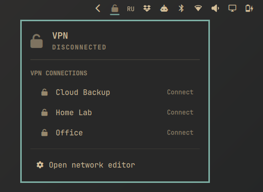
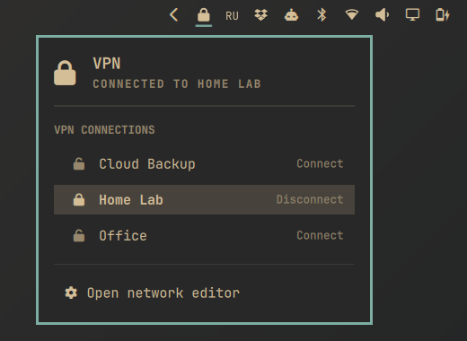

# VPN widget for the Omarchy bar

An [Omarchy](https://omarchy.org/) shell plugin that shows your VPN status in the bar and lets you connect, disconnect or cancel NetworkManager VPN and WireGuard profiles from a keyboard-friendly panel.

<p>
  
  
</p>

## Features

- Lock icon in the bar: closed when a VPN is up, open and dimmed when not. The tooltip lists active and connecting profiles.
- One click on a profile connects or disconnects it, and the panel closes so the result notification is visible.
- A connection that is still being established can be cancelled from its row.
- OpenVPN, OpenConnect, L2TP and any other NetworkManager VPN plugin, plus WireGuard.
- Updates as soon as NetworkManager reports a change (`nmcli monitor`), with a slow polling fallback.
- Gives up on a stuck connection after 30 seconds instead of nmcli's 90.
- Fully keyboard-navigable panel.
- English and Russian interface, following the language set in Omarchy.

## Requirements

| Package | Needed for | Stock Omarchy |
|---|---|---|
| `networkmanager` | everything | yes |
| `libnotify` (`notify-send`) | connect/disconnect notifications | yes, as a dependency of other stock packages |
| `networkmanager-openvpn`, `networkmanager-openconnect`, … | the VPN types you use | no |
| `network-manager-applet` | the network editor (`nm-connection-editor`) and the password prompt (`nm-applet`) | no |

The plugin itself only needs NetworkManager and `notify-send`. Without `network-manager-applet`:

- the "Open network editor" entry is replaced by a hint, and profiles have to be created with `nmcli`;
- **VPNs that ask for a password or OTP cannot connect**, because nothing answers NetworkManager's password request. Profiles with stored credentials, which includes typical WireGuard setups, are unaffected. The panel shows a specific hint when this happens.

To get both:

```bash
omarchy pkg add network-manager-applet
```

and make sure `nm-applet` runs in your session, for example by adding it to your Hyprland autostart.

## Installation

```bash
omarchy plugin add https://github.com/ValentinBasin/omarchy-vpn.git --enable
```

Omarchy asks which bar section to use; `right` is the default. To move the icon afterwards, for example next to the keyboard layout:

```bash
omarchy bar move valentinbasin.vpn --section right --after omarchy.keyboard-layout
```

Update later with `omarchy plugin update valentinbasin.vpn`.

## Removal

```bash
omarchy plugin remove valentinbasin.vpn
```

This takes the widget off the bar, together with any settings on its bar entry, and deletes the plugin folder `~/.config/omarchy/plugins/valentinbasin.vpn`. The plugin creates no other files, so nothing else is left behind.

Your NetworkManager VPN profiles are not touched, and any packages you installed for the plugin, such as `network-manager-applet`, stay installed. Remove those with `omarchy pkg drop <package>` if you no longer need them.

## What the plugin changes

The plugin never writes to your configuration. It reads its settings from its entry in `~/.config/omarchy/shell.json`, which Omarchy adds when you enable the widget, and it changes VPN state only when you click a profile: it then runs `nmcli connection up` or `down` for that profile.

## Usage

| Action | Result |
|---|---|
| Left click on the icon | Open or close the panel |
| Right click | Open the network editor |
| Middle click | Refresh now |
| Click a profile | Connect, disconnect, or cancel a connection in progress |

In the panel: arrow keys or `hjkl` move, `Enter` or `Space` activates, `Esc` closes.

The widget can be driven over IPC:

```bash
qs -p /usr/share/omarchy/shell ipc call valentinbasin.vpn toggle   # open, close, show, hide, toggle
qs -p /usr/share/omarchy/shell ipc call valentinbasin.vpn refresh
```

## Settings

In `~/.config/omarchy/shell.json`, on the widget's bar entry:

```json
{ "id": "valentinbasin.vpn", "refreshIntervalSec": 60 }
```

| Key | Default | Range | Meaning |
|---|---|---|---|
| `refreshIntervalSec` | 60 | 10–600 | Fallback polling interval. Changes normally arrive instantly through `nmcli monitor`. |

## Compatibility

Tested with Omarchy 4.5.0, Quickshell 0.3.2 and NetworkManager 1.58.

The panel is built from Omarchy's internal UI components (`BarIconButton`, `KeyboardPanel`, `PanelHero`, …). Omarchy does not guarantee their stability, so an Omarchy update can break the widget's look or behaviour. Please open an issue with your Omarchy version if that happens.

## Development

```bash
node --test tests/                      # unit tests: nmcli parsing, escaping, translations
omarchy plugin validate .               # manifest check used by `omarchy plugin add`
rsync -a --delete --exclude .git ./ ~/.config/omarchy/plugins/valentinbasin.vpn/   # try it live
```

Saved changes under `~/.config/omarchy/plugins/` reload automatically. If they do not show up, run `omarchy restart shell`.

Layout:

- `Panel.qml`: bar icon and panel UI
- `Service.qml`: nmcli processes and state
- `Model.js`: pure parsing and helper functions, covered by `tests/`
- `i18n/`: string catalogs, one file per Omarchy language code; `en.json` is the fallback

To add a language, copy `i18n/en.json` to `i18n/<code>.json` and translate the values. Keep `%1` placeholders. The tests check that every catalog has the same keys and placeholders.

## License

MIT, see [LICENSE](LICENSE).
